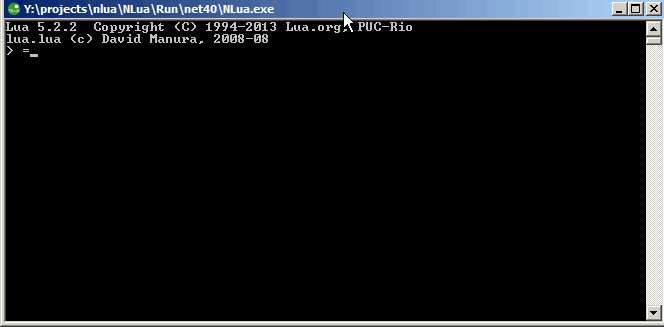

# __Titulo Novo__  
Isso é um paragrafo. Estamos na **primeira** _aula_ de ***markdown***.
## Titulo H2
### Titulo H3
#### Titulo H4
##### Titulo H5
###### Titulo H6

### Lista Ordenada
1. Primeira
2. Segunda
3. Terceira
---  
1. Primeira
1. primeira
1. Terceira

### Lista não Ordenada
- Primeira
- Secunda
---
+ Primeira
+ Primeira
---
* Primeira
* Segunda

### Citação

> Essa é uma citação.
> + Aqui tem uma lista.
> + Aqui tem uma lista.
>  1. lista **ordenada**


  

  

  

**[Google](https://www.google.com)**  
[Projeto](https://github.com/marcotulio0654/atividade_grupo_afinidade_curso)  

<https://google.com>  
<fulano@gmail.com>  

### C
``` c
int main(){
    int valor = 0;
    return 0;
}
```
### C#
``` c#
	public class SomeClass
	{
		public string MyProperty {get; private set;}
		
		public SomeClass (string param1 = "defaulValue")
		{
			MyProperty = param1;
		}


```
### Javascript
``` javascript
const a = 0;
var b = 2;
```

### Java
``` java
public static void Main(){
    system.out.println("Ola mundo")
}

```

|ID|NOME|CLASSE|  
|-|-:|:-:|
|1|Sergio|Guerreiro |
|2|Sulivan Sergio|Mago|
